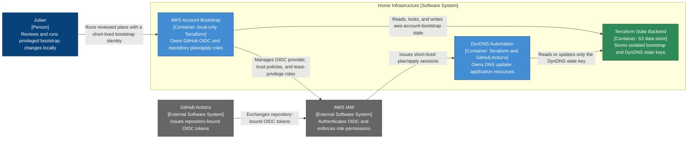

# AWS Account Bootstrap — Container Diagram

- **C4 type:** Container
- **Scope:** AWS identity and Terraform deployment control plane
- **Status:** Current/deployed as of 2026-08-19

## Deployed boundary

| Container | Technology | Responsibility |
| --- | --- | --- |
| AWS Account Bootstrap | Terraform, AWS provider, trusted local AWS session | Own account-wide OIDC and repository-bound plan/apply identities |
| DynDNS Automation | Terraform, GitHub Actions OIDC | Manage application resources without changing its own automation identity |
| Terraform State Backend | Amazon S3 | Isolate bootstrap and workload state under separate encrypted keys |

## Legend

- Blue: person
- Grey: external system
- Light blue: C4 application container
- Green: C4 data-store container
- Arrow label: protocol or intent of the relationship
