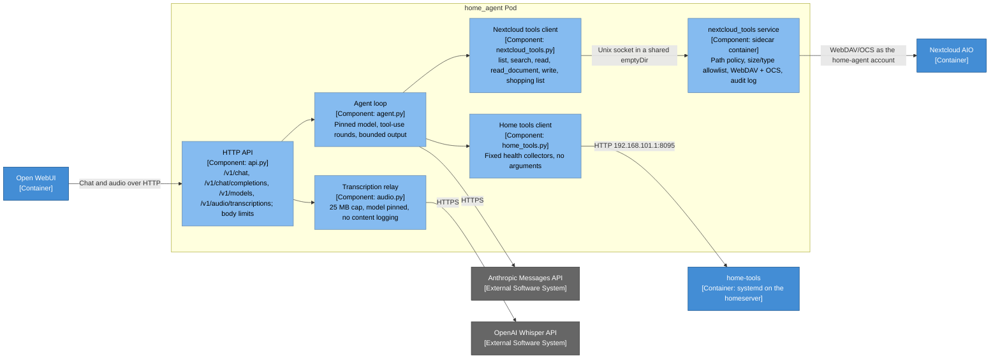

# home_agent — Component Diagram

- **C4 type:** Component
- **Scope:** The `home_agent` Pod (`infra/k3s-apps` `modules/home_agent`)
- **Status:** Current as of 2026-10-11

Source: `infra/home-infra` `ansible/roles/home_agent/files/agent/` (agent,
built into `ghcr.io/kandlerli/home-agent` by CI) and
`nextcloud_tools/` (sidecar, synced into `k3s-apps`).

## Boundaries

The agent holds the Anthropic and OpenAI keys; Open WebUI holds neither.
The sidecar holds the Nextcloud app password; the agent container does
not. Nextcloud scope is whatever Julian shares with `home-agent` under
`Shared` (ADR 0021). The full rule set is the `check-security-invariants`
skill.

## Legend

- Grey: external system
- Medium blue: container outside this Pod
- Light blue: component
