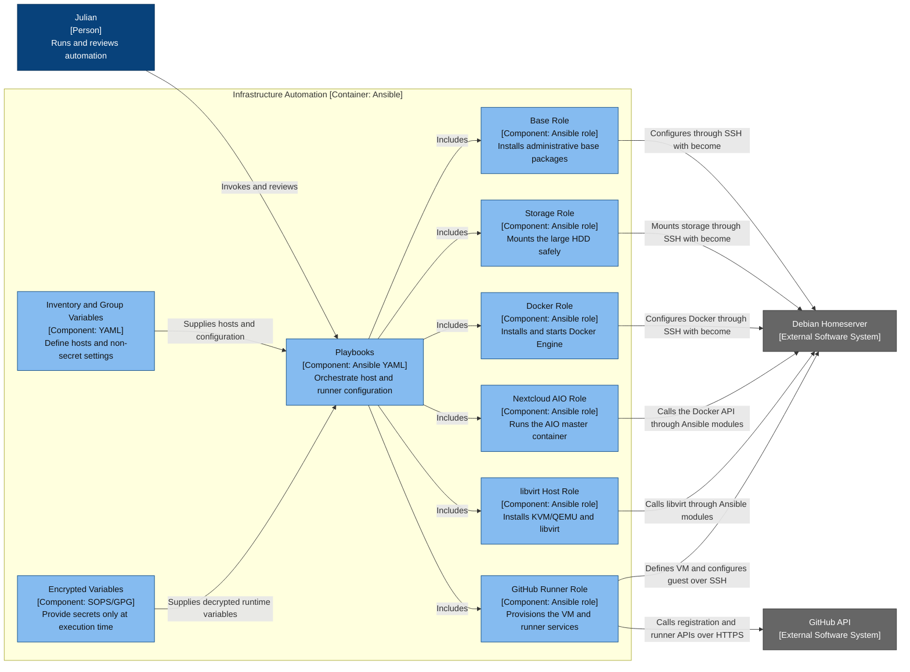

# Infrastructure Automation — Component Diagram

- **C4 type:** Component
- **Scope:** Infrastructure Automation container
- **Status:** Current committed configuration as of 2026-08-18

## Component responsibilities

| Component | Responsibility |
| --- | --- |
| Playbooks | Establish ordering and host scope |
| Inventory and Group Variables | Resolve `homeserver`, LAN address, Python interpreter, and repository configuration |
| Encrypted Variables | Keep GitHub tokens and future API keys encrypted in Git |
| Base Role | Base packages and administrative group membership |
| Storage Role | Safe mount-point ownership and UUID-based HDD mount |
| Docker Role | Docker APT repository, packages, and service |
| Nextcloud AIO Role | AIO volume and master-container configuration |
| libvirt Host Role | Hypervisor packages, service, and image cache |
| GitHub Runner Role | VM, private network, cloud-init, repository registration, and systemd services |

## Legend

- Blue: person
- Grey: external system
- Light blue: component inside the Ansible container
- Arrow label: intent and direction
