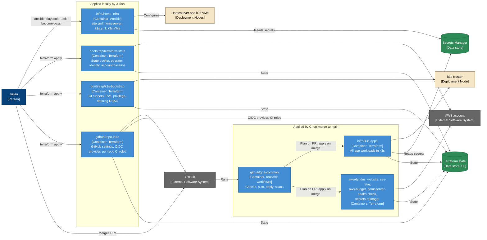

# Infrastructure Automation — Container Diagram

- **C4 type:** Container
- **Scope:** The repositories that define the infrastructure, and what each
  one manages
- **Status:** Current as of 2026-10-11

## Why the split

The local-only roots define the identities and privileges CI itself runs
with (state bucket, OIDC roles, runner RBAC), so CI must never apply them.
Ansible needs an interactive become password and stays local too. Everything
else is applied by CI on merge, with the PR review as the only gate. Details:
the repo map in `/home/julian/projects/CLAUDE.md` and
[`repositories.md`](../../repositories.md).

## Legend

- Dark blue: person
- Grey: external system
- Medium blue: repository (C4 container: deployable unit of automation)
- Green: data store
- Beige: what gets configured
