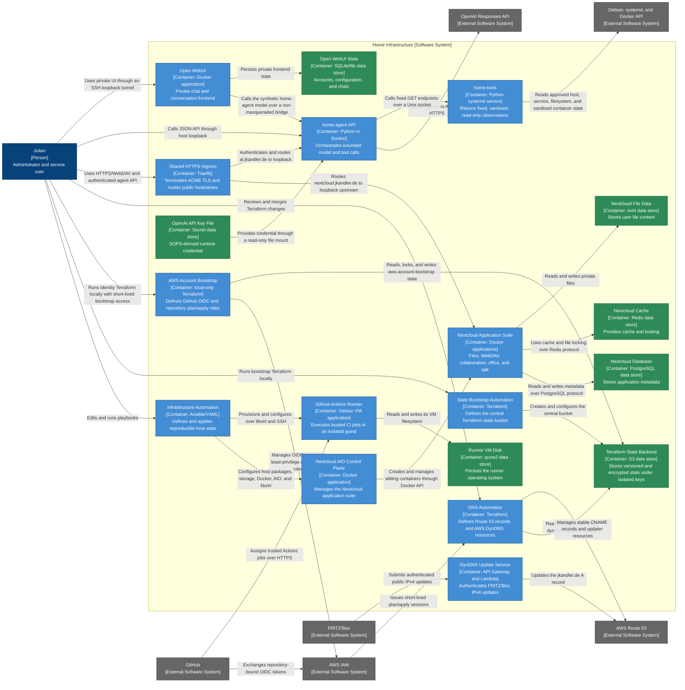

# Home Infrastructure — Container Diagram

- **C4 type:** Container
- **Scope:** Home Infrastructure software system
- **Status:** Current/configured as of 2026-08-19

In C4 terminology, a container is an application or data store. Docker and VM
placement is shown separately in the deployment diagram.

## Container catalogue

| Container | Technology | Responsibility |
| --- | --- | --- |
| Infrastructure Automation | Ansible 14.3, YAML, community collections | Converges declared infrastructure state |
| State Bootstrap Automation | Terraform, AWS provider | Defines the shared `jkandler-terraform-state` S3 bucket from a dedicated local Git repository |
| AWS Account Bootstrap | Terraform, AWS provider, trusted local session | Defines account-wide GitHub OIDC and repository-bound plan/apply identities without CI self-management |
| Terraform State Backend | Amazon S3 | Stores versioned, AES256-encrypted Terraform state with public access blocked and lock files enabled |
| DNS Automation | Terraform, AWS provider, GitHub Actions OIDC | Defines CNAME records and the least-privilege DynDNS stack |
| DynDNS Update Service | API Gateway HTTP API, Python Lambda | Authenticates FRITZ!Box requests and updates the apex IPv4 record |
| Shared HTTPS Ingress | Traefik `v3.7.1`, file provider, ACME | Routes Nextcloud and the authenticated agent without Docker API access |
| Nextcloud AIO Control Plane | Nextcloud AIO master Docker image | Manages the AIO application lifecycle |
| Nextcloud Application Suite | Nextcloud, Apache, Collabora, Talk, Imaginary, Notify Push, Whiteboard | User-facing private cloud features |
| Nextcloud Database | PostgreSQL Docker container | Application metadata |
| Nextcloud Cache | Redis Docker container | Cache and locking |
| Nextcloud File Data | ext4 on `/mnt/black-hdd` | Persistent user files |
| GitHub Actions Runner | Debian 13 VM and GitHub runner application | Trusted CI job execution |
| Runner VM Disk | qcow2 on ext4 | Guest OS persistence |
| `home-agent` API | Python 3.13, OpenAI SDK, Docker | Bounded natural-language health requests and tool orchestration |
| Open WebUI | Open WebUI `v0.11.0-slim`, Docker | Private loopback chat frontend for the synthetic `home-agent` model |
| Open WebUI State | SQLite and application files on `/var/lib/open-webui` | Persists accounts, configuration, and chat history |
| `home-tools` | Python 3 standard library, systemd | Fixed read-only host collectors over a Unix socket |
| OpenAI API Key File | Root-controlled file, read-only bind mount | Runtime credential without Docker environment-variable exposure |

## Legend

- Blue: person
- Grey: external software system
- Light blue: C4 application container
- Green: C4 data-store container
- Arrow label: protocol or intent of the relationship
