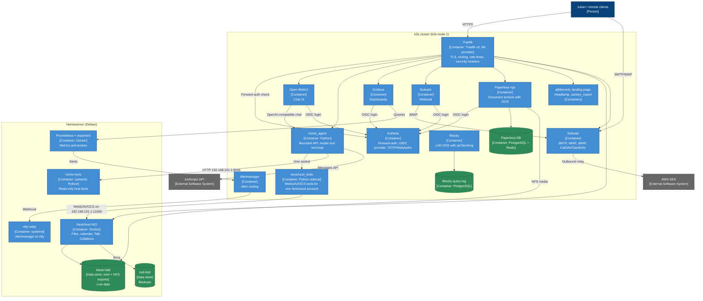

# Home Infrastructure — Container Diagram

- **C4 type:** Container
- **Scope:** Home Infrastructure software system
- **Status:** Current as of 2026-10-11

Grouped by where each container runs. Details per hostname and auth:
[`current-state.md`](../../current-state.md).

Not drawn, to keep the view readable: the CI runners (`k3s-node-2`, see
[deployment](deployment.md)), Authelia's own storage (SQLite on a PVC,
sessions in Redis), Stalwart's RocksDB PVC, and the backup jobs (listed in
`current-state.md`).

## Legend

- Dark blue: person
- Grey: external system
- Medium blue: C4 container (application)
- Green: C4 container (data store)
- Unlabelled arrows from Traefik: HTTP routing to that service
