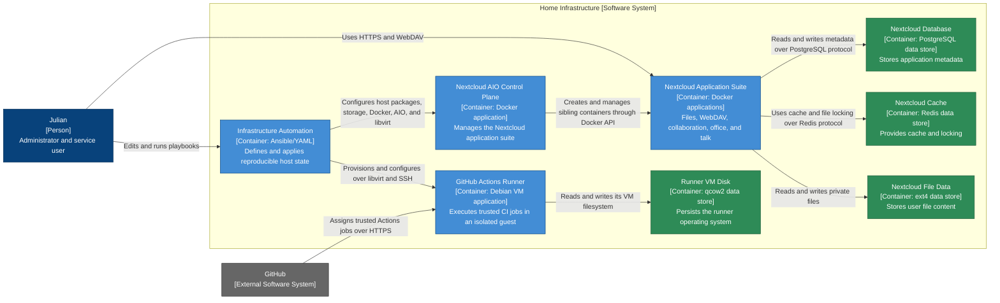

# Home Infrastructure — Container Diagram

- **C4 type:** Container
- **Scope:** Home Infrastructure software system
- **Status:** Current/configured as of 2026-08-18

In C4 terminology, a container is an application or data store. Docker and VM
placement is shown separately in the deployment diagram.

## Container catalogue

| Container | Technology | Responsibility |
| --- | --- | --- |
| Infrastructure Automation | Ansible 14.3, YAML, community collections | Converges declared infrastructure state |
| Nextcloud AIO Control Plane | Nextcloud AIO master Docker image | Manages the AIO application lifecycle |
| Nextcloud Application Suite | Nextcloud, Apache, Collabora, Talk, Imaginary, Notify Push, Whiteboard | User-facing private cloud features |
| Nextcloud Database | PostgreSQL Docker container | Application metadata |
| Nextcloud Cache | Redis Docker container | Cache and locking |
| Nextcloud File Data | ext4 on `/mnt/black-hdd` | Persistent user files |
| GitHub Actions Runner | Debian 13 VM and GitHub runner application | Trusted CI job execution |
| Runner VM Disk | qcow2 on ext4 | Guest OS persistence |

## Legend

- Blue: person
- Grey: external software system
- Light blue: C4 application container
- Green: C4 data-store container
- Arrow label: protocol or intent of the relationship
