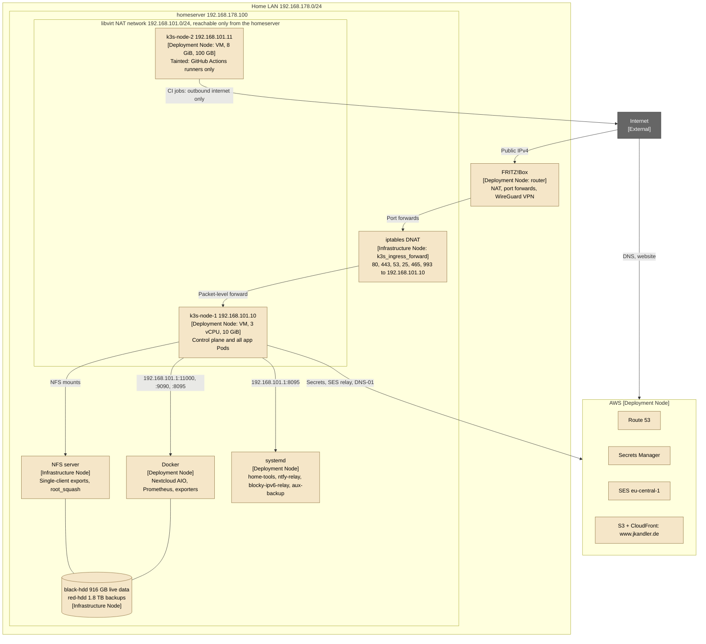

# Home Infrastructure — Deployment Diagram

- **C4 type:** Deployment
- **Scope:** Production, physical and network placement
- **Status:** Current as of 2026-10-11

## Notes

- The k3s VMs' disks are qcow2 files on the system SSD (`/var/lib/libvirt/k3s/`). VM sizes and
  networking are set in [`home-infra`](https://github.com/KandlerLi/home-infra) `ansible/playbooks/k3s.yml`.
- Nothing on the LAN can route to `192.168.101.0/24`; inbound traffic
  enters the cluster only through the DNAT relay.
- The homeserver itself answers LAN DNS on port 53 by forwarding it to
  Blocky (IPv4 via DNAT, IPv6 via `blocky-ipv6-relay`).
- Admin access from outside goes through the FRITZ!Box WireGuard VPN
  (ADR 0025), not through any forwarded port.

## Legend

- Beige: deployment or infrastructure node
- Grey: external
- Arrow label: protocol, port or intent
