# Home Infrastructure — Production Deployment Diagram

- **C4 type:** Deployment
- **Scope:** Current production environment
- **Status:** Current/configured as of 2026-08-19

```mermaid
flowchart TB
    browser["Browser / WebDAV Client<br/>[Client Device]"]
    controller["Ansible Controller<br/>[Deployment Node]<br/>/home/julian/projects/infra/home-infra"]
    github["GitHub<br/>[External Software System]"]
    openai["OpenAI Responses API<br/>[External Software System]"]
    letsencrypt["Let's Encrypt ACME<br/>[External Software System]"]
    dns["Route 53 and Dynamic DNS<br/>[Infrastructure Nodes]"]

    subgraph edge["Home Network Edge [Infrastructure Node]"]
        fritzbox["Fritzbox<br/>[Router/NAT/Firewall]<br/>Public ingress and LAN routing"]
    end

    subgraph physical["Fujitsu ESPRIMO P900 [Physical Deployment Node]"]
        subgraph debian["Debian 13.6 [Operating System Node]"]
            ssh["OpenSSH<br/>[Container: Host service]<br/>TCP 22"]
            tools["home-tools.service<br/>[Container Instance]<br/>Fixed collectors on protected Unix socket"]
            socket["/run/home-tools<br/>[Infrastructure Node]<br/>Group-restricted socket directory"]
            agent_key["/etc/home-agent/openai-api-key<br/>[Infrastructure Node]<br/>Root-controlled credential file"]
            subgraph docker["Docker Engine [Container Runtime Node]"]
                docker_daemon["Docker Daemon<br/>[Infrastructure Node]<br/>Manages images, networks, volumes, and containers"]
                ingress["Traefik v3.7.1<br/>[Container Instance]<br/>Host network TCP 80/443; file routing; no Docker socket"]
                aio_master["Nextcloud AIO Master<br/>[Container Instance]<br/>TCP 8080, 8443"]
                aio_apache["Nextcloud Apache<br/>[Container Instance]<br/>127.0.0.1:11000"]
                aio_app["Nextcloud and Supporting Apps<br/>[Container Instances]"]
                aio_db["PostgreSQL and Redis<br/>[Container Instances]"]
                agent["home-agent<br/>[Container Instance]<br/>127.0.0.1:8090, read-only root, no capabilities"]
                webui["Open WebUI v0.11.0-slim<br/>[Container Instance]<br/>127.0.0.1:8091, public via Traefik"]
            end

            subgraph hypervisor["libvirt/KVM/QEMU [Virtualisation Node]"]
                libvirt_daemon["libvirt Daemon<br/>[Infrastructure Node]<br/>Manages networks and virtual machines"]
                subgraph vm["GitHub Runner VM [Debian 13 Deployment Node]"]
                    runner["GitHub Actions Runner<br/>[Container Instance]<br/>One service per configured repository"]
                end
            end
        end

        system_disk["System SSD<br/>[Infrastructure Node]<br/>/dev/sdb2 mounted at /"]
        hdd["Large HDD<br/>[Infrastructure Node]<br/>/dev/sda1 mounted at /mnt/black-hdd"]
        webui_data["Open WebUI State<br/>[Infrastructure Node]<br/>/var/lib/open-webui"]
    end

    browser -->|"Resolves public hostnames with"| dns
    browser -->|"Sends HTTPS and WebDAV traffic"| fritzbox
    fritzbox -->|"Forwards public TCP 80/443 to 192.168.178.100"| ingress
    ingress -->|"Routes nextcloud.jkandler.de to 127.0.0.1:11000"| aio_apache
    ingress -->|"Routes ai.jkandler.de catch-all to 127.0.0.1:8091"| webui
    ingress -->|"Basic-Auth routes exact health/chat paths to 127.0.0.1:8090"| agent
    ingress -->|"Obtains and renews hostname certificates over ACME"| letsencrypt
    controller -->|"Applies Ansible over SSH with become"| ssh
    ssh -->|"Configures host services"| docker_daemon
    ssh -->|"Configures hypervisor and guest"| libvirt_daemon
    ssh -->|"Invokes the private API through host loopback"| agent
    ssh -->|"Forwards private browser access to 127.0.0.1:8091"| webui
    aio_master -->|"Manages sibling containers through Docker API"| docker_daemon
    aio_apache -->|"Forwards application requests over the AIO network"| aio_app
    aio_app -->|"Uses database and cache protocols"| aio_db
    aio_app -->|"Reads and writes Nextcloud files"| hdd
    libvirt_daemon -->|"Runs VM on private NAT network 192.168.100.0/24"| runner
    runner -->|"Polls for and reports Actions jobs over HTTPS"| github
    runner -->|"Reads and writes qcow2 disk"| hdd
    agent -->|"Calls model over HTTPS"| openai
    webui -->|"Calls OpenAI-compatible API over non-masqueraded bridge"| agent
    webui -->|"Persists account and chat state"| webui_data
    agent -->|"Uses read-only mounted socket directory"| socket
    socket -->|"Carries fixed HTTP GET requests"| tools
    agent_key -->|"Is mounted read-only"| agent
    tools -->|"Reads sanitised container state"| docker_daemon
    debian -->|"Runs operating system from"| system_disk

    classDef client fill:#08427b,color:#fff,stroke:#052e56
    classDef external fill:#666,color:#fff,stroke:#333
    classDef node fill:#f5e6c8,color:#111,stroke:#9b6b21
    classDef instance fill:#85bbf0,color:#111,stroke:#0b4884
    class browser client
    class github,openai,letsencrypt external
    class controller,dns,fritzbox,ssh,docker_daemon,libvirt_daemon,system_disk,hdd,webui_data,socket,agent_key node
    class ingress,aio_master,aio_apache,aio_app,aio_db,runner,tools,agent,webui instance
```

## Deployment nodes

| Node | Technology | Notes |
| --- | --- | --- |
| Fritzbox | Router/NAT/firewall | External configuration; not managed by Ansible |
| Physical host | Fujitsu ESPRIMO P900 | 4 CPU threads, 16 GiB RAM, no dedicated GPU |
| Debian host | Debian 13.6 | Runs Docker, libvirt, SSH, and mounted storage |
| Docker Engine | Docker CE | Runs the Nextcloud AIO suite, `home-agent`, and Open WebUI |
| Shared ingress | Traefik `v3.7.1` | Host-network TLS termination and file-based routing; no Docker socket |
| `home-tools` | Python 3 systemd service | Fixed read-only collectors on a group-protected Unix socket |
| `home-agent` | Python 3.13 Docker container | Loopback-only API with hardened container settings |
| Open WebUI | Digest-pinned Docker container | Public via Traefik; loopback upstream; non-masqueraded bridge |
| GitHub runner VM | KVM/QEMU, Debian 13 | Private NAT at `192.168.100.10` |
| System SSD | ext4 | Root operating system filesystem |
| Large HDD | ext4 | Nextcloud data and runner VM files |

## Network bindings

- Host LAN: `192.168.178.100/24`
- Nextcloud AIO bridge: `172.18.0.0/16`
- Runner NAT: `192.168.100.0/24`
- Shared HTTPS ingress: TCP 80/443 on all host addresses
- Nextcloud Apache upstream: `127.0.0.1:11000` only
- Traefik health endpoint: `127.0.0.1:8082` only
- Home-agent API: `127.0.0.1:8090` only
- Open WebUI: `127.0.0.1:8091` only
- Frontend bridge: `home-agent-frontend`, IP masquerading disabled
- Agent hostname: `ai.jkandler.de`; Open WebUI auth for the UI, Basic Auth for
  exact legacy API routes
- Public DNS has no AAAA record, although the host has IPv6 addresses.

## Legend

- Blue: client/person device
- Grey: external software system
- Beige: deployment or infrastructure node
- Light blue: deployed C4 container instance
- Nested boxes: deployment-node containment
- Arrow label: protocol or deployment relationship intent
