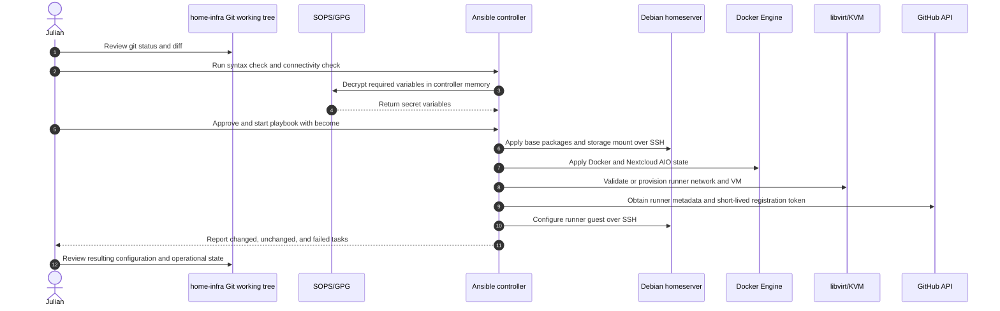

# Infrastructure Apply — Dynamic Diagram

- **C4 type:** Dynamic
- **Scope:** One reviewed Ansible deployment
- **Status:** Current workflow

## Flow constraints

- The human reviews changes before deployment.
- Long-lived GitHub credentials remain on the controller.
- The runner VM receives only short-lived registration credentials.
- Destructive recovery of orphaned VM or disk state is deliberately manual.
- An AI agent is not part of the current deployment sequence.

## Legend

- Actor: human operator
- Participant: C4 person, container, component, or external system instance
- Solid arrow: synchronous request/action
- Dashed arrow: result or response
