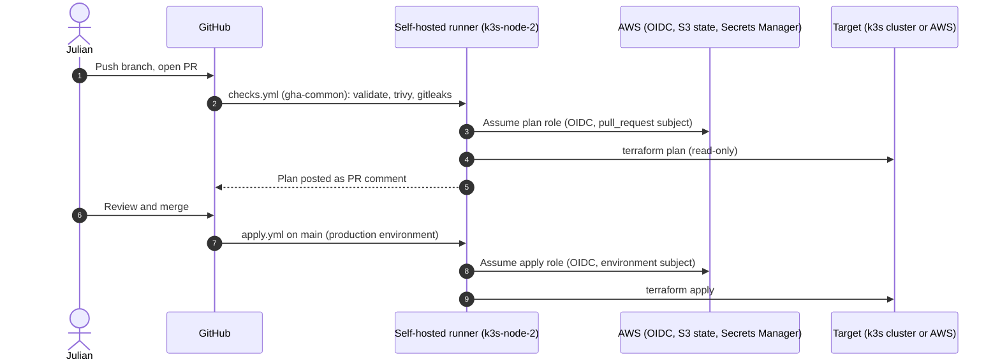
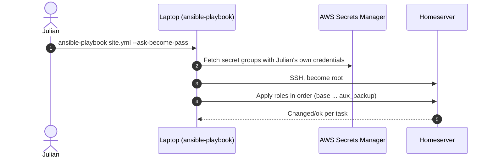

# Change Rollout — Dynamic Diagrams

- **C4 type:** Dynamic
- **Scope:** How a change reaches production, for a CI-applied Terraform
  repo and for the Ansible-managed homeserver
- **Status:** Current as of 2026-10-11

## CI-applied Terraform repo (e.g. [`k3s-apps`](https://github.com/KandlerLi/k3s-apps))

## Ansible ([`home-infra`](https://github.com/KandlerLi/home-infra))

`k3s.yml` follows the same pattern for the k3s VMs and is deliberately run
separately from `site.yml`. The locally applied Terraform roots
(`repo-infra`, `terraform-state`, `k3s-bootstrap`) are run by Julian
through each repo's `scripts/roll-out.sh`.
