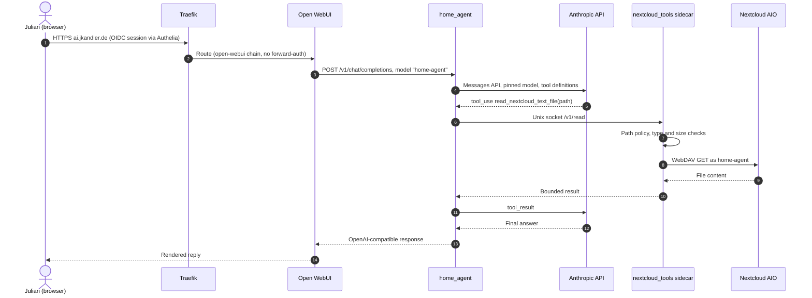

# home_agent — Dynamic Diagram: chat request with a tool call

- **C4 type:** Dynamic
- **Scope:** One chat message in Open WebUI that makes the model read a
  Nextcloud file
- **Status:** Current as of 2026-10-11

Steps 4–11 repeat for each tool round, at most 6 (`DEFAULT_MAX_TOOL_ROUNDS`).
Health questions use `home-tools` over `192.168.101.1:8095` instead of the
sidecar.
