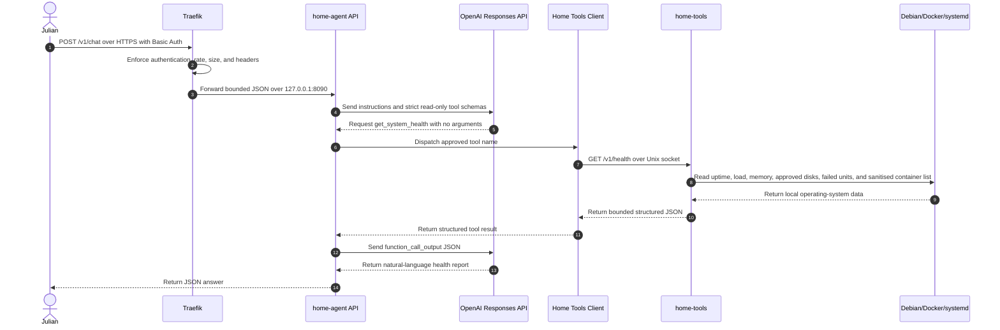

# Agent Health Check — Dynamic Diagram

- **C4 type:** Dynamic
- **Scope:** Deployed request: “Check my homeserver.”
- **Status:** Current and publicly verified as of 2026-08-19

## Verified result

The initial production check on 2026-08-18 completed with HTTP 200. It reported root
filesystem usage of 50.9%, `/mnt/black-hdd` usage of 15.0%, no failed systemd
units, and healthy/running Docker services. On 2026-08-19 the public endpoint
returned HTTP 401 without credentials and HTTP 200 for authenticated health and
chat requests.

## Failure behaviour

- Individual collectors return `unavailable` without raw exception details.
- Unknown tools and non-empty tool arguments are rejected.
- Tool responses and HTTP requests have byte limits.
- Model tool rounds and total tool calls have hard limits.
- The API returns a generic failure instead of SDK or credential details.
- No remediation action follows the report automatically.

## Legend

- Actor: human caller
- Participant: deployed C4 container, component, or external system instance
- Solid arrow: request/action
- Dashed arrow: result/response
