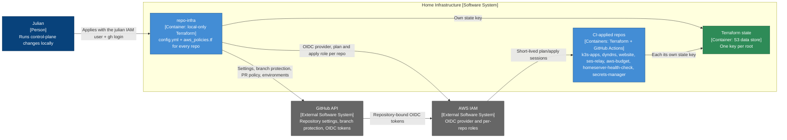

# Repository Infrastructure — Container Diagram

- **C4 type:** Container
- **Scope:** GitHub repository configuration and the AWS identity control
  plane for CI
- **Status:** Current as of 2026-10-11

| Container | Technology | Responsibility |
| --- | --- | --- |
| repo-infra | Terraform (GitHub + AWS providers), local only | Every repo's GitHub settings; the account-wide OIDC provider; a read-only plan role (PR subject) and an apply role (`production` environment subject) per AWS-deploying repo |
| CI-applied repos | Terraform via `gha-common` workflows | Manage their own resources; can never change their own trust or policies |
| Terraform state | S3 (`bootstrap/terraform-state`) | Isolated state per root; the plan role can only read its own key |

Adding a repo: the `onboard-new-repo` skill. Decisions: ADR 0009, 0010,
0022.

## Legend

- Dark blue: person
- Grey: external system
- Medium blue: C4 application container
- Green: C4 data-store container
