# Repository Infrastructure — Container Diagram

- **C4 type:** Container
- **Scope:** GitHub repository configuration and AWS identity control plane
- **Status:** Current/deployed as of 2026-08-21

```mermaid
flowchart LR
    operator["Julian<br/>[Person]<br/>Reviews and runs privileged control-plane changes locally"]
    github_api["GitHub API<br/>[External Software System]<br/>Repository settings, Actions permissions, OIDC tokens"]
    aws["AWS IAM<br/>[External Software System]<br/>Authenticates OIDC and enforces role permissions"]

    subgraph infrastructure["Home Infrastructure [Software System]"]
        repo_infra["Repository Infrastructure<br/>[Container: local-only Terraform]<br/>Owns GitHub repo settings, OIDC provider, and repository plan/apply roles"]
        dyndns_iac["DynDNS Automation<br/>[Container: Terraform and GitHub Actions]<br/>Owns DNS updater application resources"]
        state["Terraform State Backend<br/>[Container: S3 data store]<br/>Stores isolated repo-infra and DynDNS state keys"]
    end

    operator -->|"Runs reviewed plans with a short-lived bootstrap identity"| repo_infra
    repo_infra -->|"Manages repository settings, Actions permissions, environments"| github_api
    repo_infra -->|"Manages OIDC provider, trust policies, and least-privilege roles"| aws
    repo_infra -->|"Reads, locks, and writes repo-infra state"| state
    github_api -->|"Exchanges repository-bound OIDC tokens"| aws
    aws -->|"Issues short-lived plan/apply sessions"| dyndns_iac
    dyndns_iac -->|"Reads or updates only the DynDNS state key"| state

    classDef person fill:#08427b,color:#fff,stroke:#052e56
    classDef external fill:#666,color:#fff,stroke:#333
    classDef container fill:#438dd5,color:#fff,stroke:#0b4884
    classDef datastore fill:#2e8b57,color:#fff,stroke:#1d5c3a
    class operator person
    class github_api,aws external
    class repo_infra,dyndns_iac container
    class state datastore
```

## Deployed boundary

| Container | Technology | Responsibility |
| --- | --- | --- |
| Repository Infrastructure | Terraform, GitHub provider, AWS provider, trusted local AWS/GitHub session | Own GitHub repository settings plus account-wide OIDC and repository-bound plan/apply identities |
| DynDNS Automation | Terraform, GitHub Actions OIDC | Manage application resources without changing its own automation identity |
| Terraform State Backend | Amazon S3 | Isolate repo-infra and workload state under separate encrypted keys |

## History

This container was originally split across two Terraform roots: `dyndns`
itself (initial manual identity setup), then a dedicated `aws-account-bootstrap`
root (ADR 0006, 2026-08-19), and a separately created `github-infra` root for
GitHub-side repository settings (ADR 0009, 2026-08-20). They were consolidated
into this single `repo-infra` container on 2026-08-21 (ADR 0010) so that
adding a new AWS-deploying GitHub repository requires one config change and
one Terraform apply instead of coordinating two separate roots.

## Legend

- Blue: person
- Grey: external system
- Light blue: C4 application container
- Green: C4 data-store container
- Arrow label: protocol or intent of the relationship
