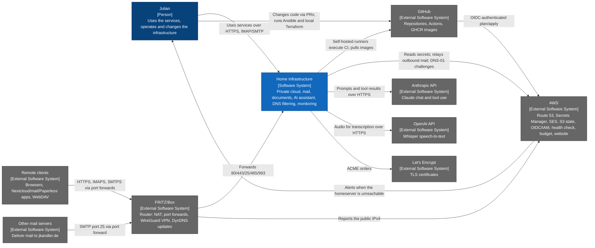

# Home Infrastructure — System Context Diagram

- **C4 type:** System context
- **Scope:** Home Infrastructure software system
- **Status:** Current as of 2026-10-11

## Element responsibilities

| Element | C4 type | Responsibility |
| --- | --- | --- |
| Julian | Person | Sole user and operator; merges every PR |
| Home Infrastructure | Software system | Everything running on the homeserver and its k3s VMs |
| Remote clients | External software system | Reach the public hostnames listed in `current-state.md` |
| Other mail servers | External software system | Inbound SMTP to Stalwart |
| GitHub | External software system | Source of truth for all code; CI orchestration; private GHCR images |
| AWS | External software system | DNS, secrets, outbound mail relay, Terraform state, CI identities, outside-in health check, cost alerts, the static website |
| Anthropic API | External software system | Model behind `home_agent` |
| OpenAI API | External software system | Whisper behind the transcription relay |
| Let's Encrypt | External software system | Certificates for Traefik (DNS-01) and Stalwart (HTTP-01) |
| FRITZ!Box | External software system | Home router; configured by hand, not in any repo |

## Legend

- Dark blue: person
- Blue: software system in scope
- Grey: external software system
- Arrow label: intent of the directed relationship
