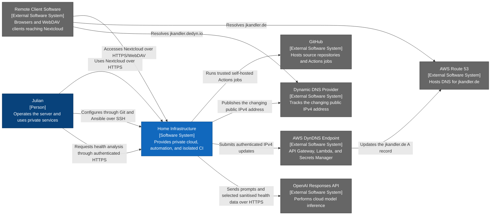

# Home Infrastructure — System Context Diagram

- **C4 type:** System context
- **Scope:** Home Infrastructure software system
- **Status:** Current/configured as of 2026-08-19

## Element responsibilities

| Element | C4 type | Responsibility |
| --- | --- | --- |
| Julian | Person | Administration and private service use |
| Home Infrastructure | Software system | Operates Nextcloud, reproducible configuration, storage, and isolated CI |
| GitHub | External software system | Source hosting, runner registration, and Actions job coordination |
| AWS Route 53 | External software system | DNS authority for `jkandler.de` |
| AWS DynDNS Endpoint | External software system | Receives authenticated FRITZ!Box updates and changes the apex A record |
| Dynamic DNS Provider | External software system | Dynamic record for the public IPv4 connection |
| OpenAI Responses API | External software system | Cloud inference for bounded health requests and tool results |
| Remote Client Software | External software system | Browsers and WebDAV clients outside the LAN |

## Legend

- Blue: person
- Dark blue: software system in scope
- Grey: external software system
- Arrow label: intent of the directed relationship

The agent is part of Home Infrastructure at this level. Its container API is
loopback-only, while Traefik provides the public authenticated endpoint at
`ai.jkandler.de`.
