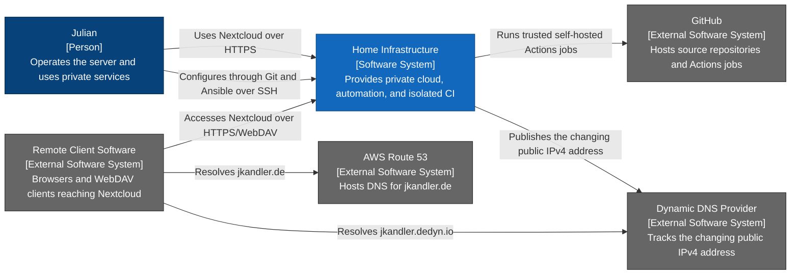

# Home Infrastructure — System Context Diagram

- **C4 type:** System context
- **Scope:** Home Infrastructure software system
- **Status:** Current/configured as of 2026-08-18

## Element responsibilities

| Element | C4 type | Responsibility |
| --- | --- | --- |
| Julian | Person | Administration and private service use |
| Home Infrastructure | Software system | Operates Nextcloud, reproducible configuration, storage, and isolated CI |
| GitHub | External software system | Source hosting, runner registration, and Actions job coordination |
| AWS Route 53 | External software system | DNS authority for `jkandler.de` |
| Dynamic DNS Provider | External software system | Dynamic record for the public IPv4 connection |
| Remote Client Software | External software system | Browsers and WebDAV clients outside the LAN |

## Legend

- Blue: person
- Dark blue: software system in scope
- Grey: external software system
- Arrow label: intent of the directed relationship

The proposed cloud AI provider is intentionally absent because no agent is
deployed.
