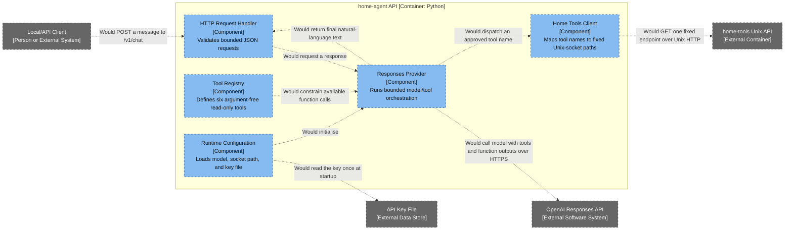

# home-agent API — Component Diagram

- **C4 type:** Component
- **Scope:** `home-agent` API container
- **Status:** Proposed; implemented locally but not deployed

## Tool registry

| Model tool | Fixed local endpoint | Data returned |
| --- | --- | --- |
| `get_system_health` | `/v1/health` | Combined status for every approved check |
| `get_cpu_and_load` | `/v1/system` | Hostname, uptime, CPU count, and load averages |
| `get_memory_usage` | `/v1/memory` | Memory and swap totals and usage |
| `get_disk_usage` | `/v1/disks` | Usage of `/` and `/mnt/black-hdd` only |
| `get_systemd_failures` | `/v1/systemd/failed` | Failed unit name, state, and bounded description |
| `get_docker_status` | `/v1/docker/containers` | Container name, image, state, and bounded status |

No tool accepts a command, path, container name, unit name, or free-form
argument.

## Legend

- Grey: person, external system, external container, or external data store
- Light blue: component inside `home-agent`
- Dashed styling: proposed/not deployed
