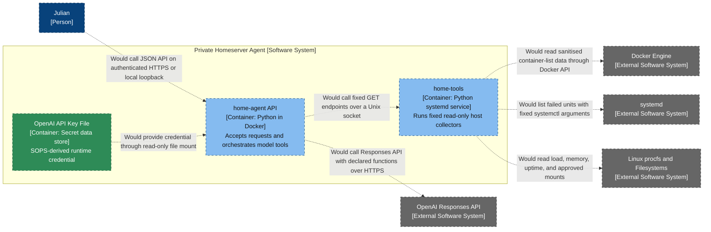

# Private Homeserver Agent — Container Diagram

- **C4 type:** Container
- **Scope:** Private Homeserver Agent software system
- **Status:** Proposed; not deployed

## Container catalogue

| Container | Technology | Responsibility |
| --- | --- | --- |
| `home-agent` API | Python 3.13, OpenAI Python SDK, Docker | Validate API requests, perform bounded tool-calling loop, return natural-language response |
| `home-tools` | Python 3 standard library, systemd | Expose fixed read-only structured host checks over a Unix socket |
| API key file | Root-controlled host file and read-only bind mount | Avoid Docker environment-variable exposure of the API key |

## Security properties

- The model chooses from declared tools but cannot define commands or paths.
- The model-facing container does not receive `/var/run/docker.sock`.
- `home-tools` extracts only container name, image, state, and status.
- Tool calls accept no arguments in the first milestone.
- Requests and tool rounds have fixed size/count limits.

## Legend

- Blue: person
- Grey: external software system
- Light blue: proposed C4 application container
- Green: proposed secret data store
- Dashed styling: proposed/not deployed
