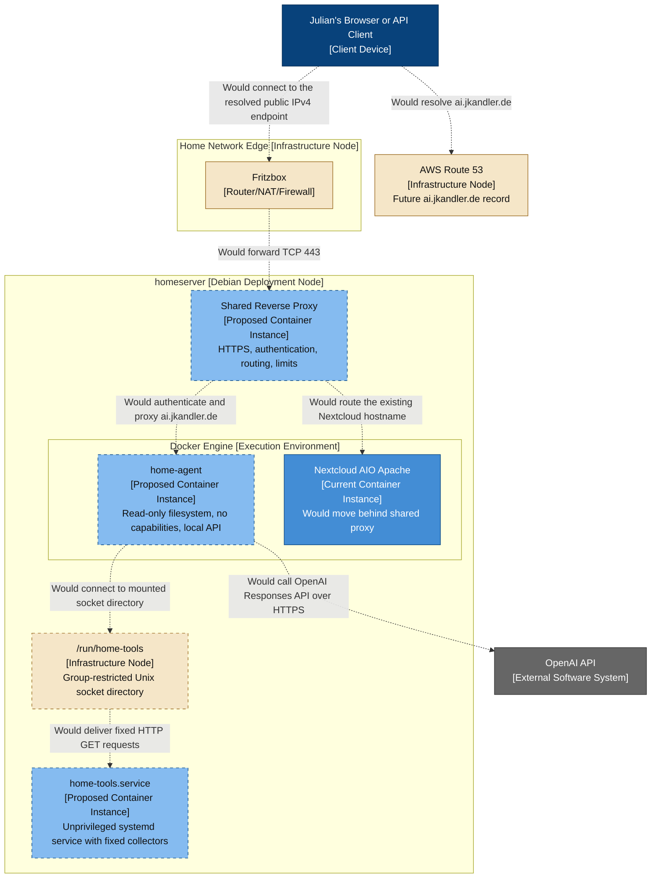

# Private Homeserver Agent — Proposed Deployment Diagram

- **C4 type:** Deployment
- **Scope:** Proposed production deployment, including authenticated ingress
- **Status:** Proposed; dashed elements and relationships are not deployed

## Important sequencing

The local agent milestone does not require the shared reverse proxy. Its API
would initially bind only to `127.0.0.1:8090`.

Publishing `ai.jkandler.de` is a later change because Nextcloud AIO currently
owns port 443. A safe public deployment requires:

1. configure Nextcloud AIO for supported reverse-proxy mode
2. place a shared reverse proxy on ports 80/443
3. preserve and validate the existing Nextcloud hostname first
4. add independent agent authentication and rate limits
5. create `ai.jkandler.de` DNS without adding an unverified AAAA record
6. expose the agent only after local and external security tests pass

## Legend

- Blue: proposed client
- Grey: external software system
- Beige: infrastructure/deployment node
- Light blue with dashed border: proposed container instance
- Solid blue: existing Nextcloud instance that would be migrated
- Dashed relationship: proposed/not deployed
