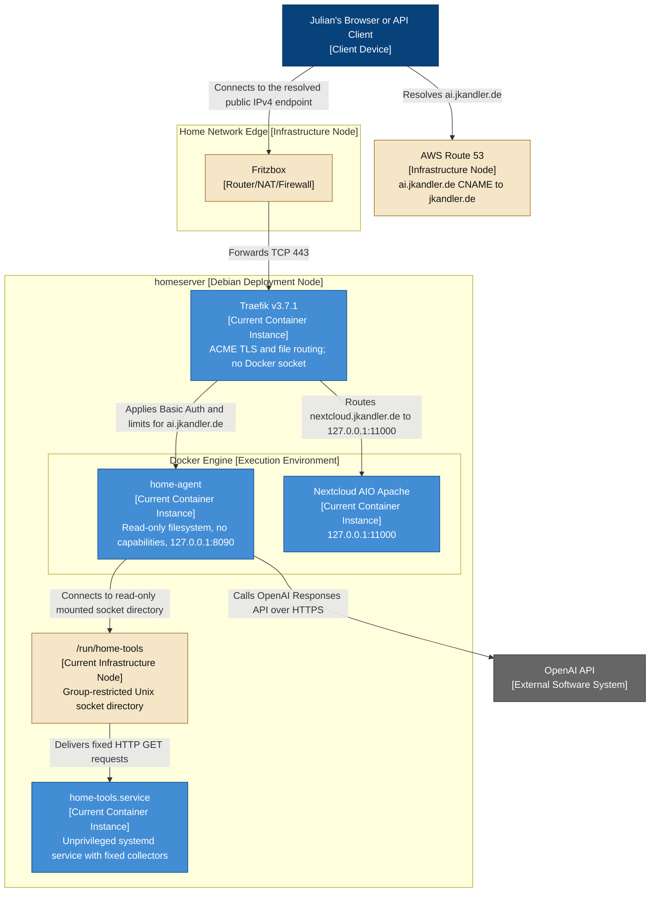

# Public Home-Agent Routing — Deployment Diagram

- **C4 type:** Deployment
- **Scope:** Authenticated agent publication through shared ingress
- **Status:** Current and verified as of 2026-08-19

## Important sequencing

The local agent milestone is complete. Its API binds only to
`127.0.0.1:8090`.

Traefik owns ports 80/443, the Nextcloud migration is complete, and the agent
route is deployed with:

1. a preserved and verified Nextcloud hostname
2. independent agent authentication, rate limits, and request-size limits
3. `ai.jkandler.de` DNS without an AAAA record
4. successful local and external security tests

## Legend

- Blue: client
- Grey: external software system
- Beige: infrastructure/deployment node
- Solid blue: deployed proxy, agent, collector, and Nextcloud instances
- Solid relationship: deployed traffic flow
