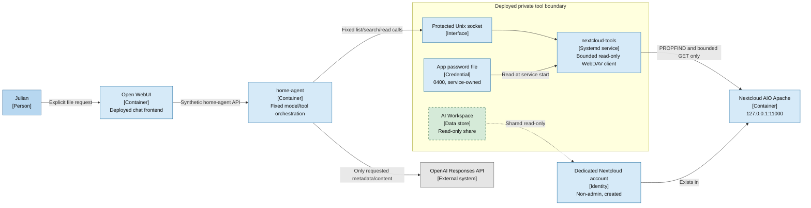

# Read-Only Nextcloud Tools — Deployed Private View

Scope: C4 container/deployment view for the read-only Nextcloud retrieval
milestone. The private service path is deployed; only the dashed data share and
persistent desired-state flag remain pending.

## Allowed operations

| Operation | Bound |
| --- | --- |
| List | One relative directory below `AI Workspace` |
| Search | Filename/path only; 500 scanned entries; depth four; 50 matches |
| Read | Approved UTF-8 text extensions; maximum 256 KiB |

The returned fields are path, name, file/folder type, size, modification time,
MIME type, ETag, file ID, permissions, and preview availability. Owner names,
shares, arbitrary properties, raw XML, and credentials are discarded.

## Trust boundaries

- Open WebUI never receives a Nextcloud credential or socket.
- `home-agent` gets only the Unix socket and a supplementary group when the
  integration is explicitly enabled.
- `nextcloud-tools` runs as a separate non-login user without Docker access,
  capabilities, home access, or non-loopback networking.
- The service constructs every WebDAV path below a fixed root and rejects
  absolute paths, `..`, backslashes, oversized arguments, and unexpected keys.
- No `PUT`, `DELETE`, `MOVE`, `COPY`, `MKCOL`, or other write method exists.
- The guarded bootstrap creates the non-admin service account and limited token.
  The personal-data owner creates the read-only folder share manually; Ansible
  receives no owner-account credential and does not alter shares.
- Guarded recovery replaced and revoked the unusable bootstrap token, installed
  the credential, and deployed the service/socket. The share remains manual and
  absent until the owner grants it.

## Deliberately deferred

- PDF and Office text extraction
- image bytes, thumbnails, OCR, embeddings, or semantic photo search
- background crawling or bulk indexing
- file creation, update, move, rename, or deletion
- calendar, contacts, mail, notes, or other Nextcloud APIs

## Legend

- Solid blue: currently deployed component or request path
- Dashed beige/green: prepared but not deployed data share
- Grey: external cloud model provider
