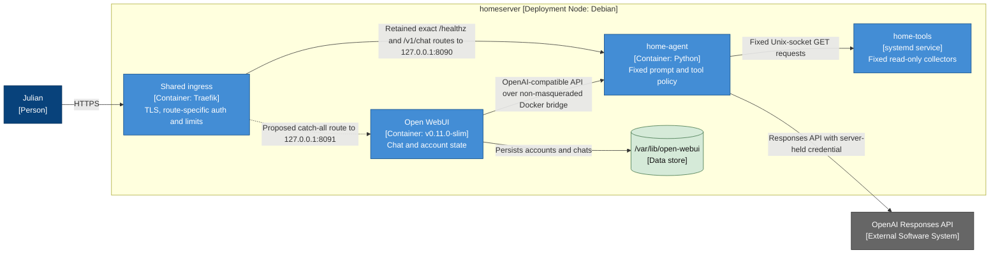

# Open WebUI Frontend — Deployment View

- **C4 type:** Deployment
- **Scope:** Private chat frontend and proposed publication at `ai.jkandler.de`
- **Status:** Private runtime deployed; public route not deployed as of 2026-08-19

## Security boundaries

- Open WebUI receives only a non-secret placeholder key. The existing
  `home-agent` continues to hold the real provider credential and defines the
  server-side system prompt and allowed tools.
- Caller-provided system/developer messages are discarded by the compatibility
  API. Conversation length, message length, request bytes, tool calls, and
  model rounds remain bounded.
- Open WebUI has no Docker socket, host filesystem access, shell, code
  interpreter, plugin installation, file upload, web search, or workspace tool
  access. Its non-masqueraded Docker bridge reaches `home-agent`, permits the
  loopback publication, and blocks external egress.
- The public UI uses Open WebUI's own account login. HTTP Basic Auth cannot be
  stacked on that route because both mechanisms need the `Authorization`
  header. The retained direct API routes continue to use Traefik Basic Auth,
  and the first Open WebUI administrator is created before publication.
- Open WebUI account and chat data is new sensitive state. It is kept in
  `/var/lib/open-webui` and must be backed up before upgrades.
- The upstream image rewrites static assets at startup, so its root filesystem
  cannot currently be read-only. A non-root UID, dropped capabilities,
  `no-new-privileges`, resource limits, an isolated network, and a digest pin
  reduce the residual risk.

## Deliberately excluded

Nextcloud is not connected to Open WebUI or `home-agent` in this milestone.
Future search, document creation, and file updates require a separate,
least-privilege Nextcloud tool service with explicit path/action policies,
confirmation for writes, audit logs, and dedicated credentials.

## Legend

- Solid blue node/relationship: currently deployed component or route
- Dashed beige relationship: prepared but not deployed
- Grey node: external software system
