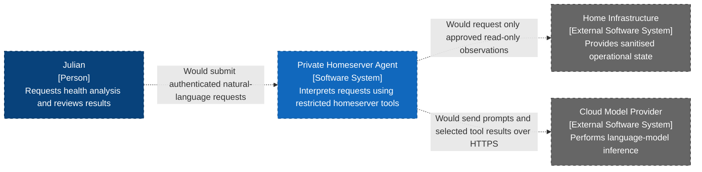

# Private Homeserver Agent — System Context Diagram

- **C4 type:** System context
- **Scope:** Private Homeserver Agent software system
- **Status:** Proposed; not deployed

## Scope notes

The cloud model does not directly connect to the host. Trusted local code
decides how every tool obtains and filters information. Nextcloud document
retrieval is outside this system context and outside the first milestone.

## Legend

- Blue: person
- Dark blue: proposed software system in scope
- Grey: external software system
- Dashed border and relationship: proposed/not deployed
